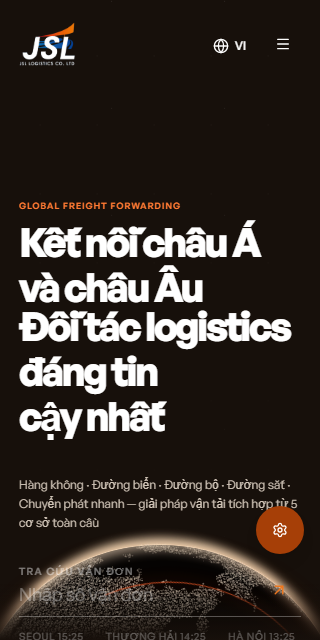
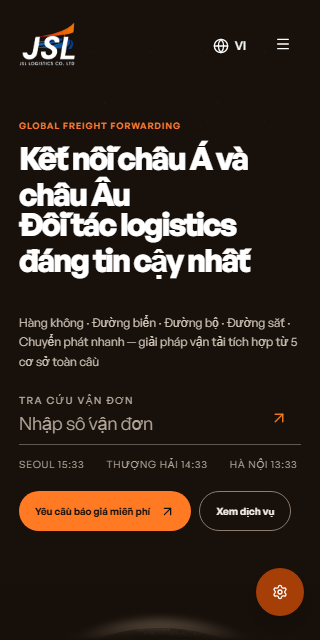

# 작은 화면 히어로 보정

기준 소스는 `c9baefeb3277d8f005db8512a3deb6a8bafb1b1f`이다. 사용자가 현재 화면의 어색한 부분을 찾아 수정하도록 요청해 첫 화면과 회사소개·문의 화면을 실제 로컬 운영 빌드에서 확인했다.

## 발견과 수정

- 320×640 베트남어 화면에서 상단 여백과 긴 제목 때문에 조회 칸 일부와 CTA가 첫 화면 아래로 잘렸다. 폭600px 이하이면서 높이740px 이하인 경우에만 여백·제목 크기를 줄이고 지구본을 내려 조회 칸과 두 CTA가 먼저 보이도록 했다. 긴 화면과 PC의 승인 구도를 바꾸지 않았다.
- 조회 placeholder는 단색 배경 기준 대비3.18:1, 현지 시각은2.68:1이었다. 같은 따뜻한 계열의 밝은 색으로 바꿔8.2:1로 높였다. 모든 움직이는 지구본 픽셀에 대한 대비 측정은 아니다.
- 동작 줄이기가 켜진 상태로 페이지를 열면 설정을 꺼도 모션이 생기지 않았고, 반대 전환에서는 GSAP 변환이 남았다. GSAP matchMedia에 모션 조건을 포함해 타임라인을 생성·해제한다. 기존 이동값·길이·타이밍은 유지한다.

320px 조회 칸의 intrinsic 폭 초과 가능성도 코드 검토에서 제기됐지만 실제 네 언어 측정에서 넘침이 없어 해당 부분은 수정하지 않았다.

## 실제 화면

| 변경 전320×640 | 변경 후320×640 |
| --- | --- |
|  |  |

PC 전후는 `before-en-1440-hero.png`, `after-en-1440-hero.png`다. 작은 영어 화면은 `after-en-390x640-hero.png`에 있다. 짧은 화면에서는 지구본 가장자리가 먼저 보이고 기존 스크롤 이동으로 이어진다.

## 검사와 보존 범위

- 최종 `next build --webpack`: 컴파일·TypeScript·78개 정적 페이지 통과. 변경 TSX의 ESLint와 `git diff --check` 통과.
- ko/en/zh/vi × 320×640,390×640,390×844,768×900의16조건: 가로 넘침0, 조회 칸 내부 넘침0, 두 CTA 화면 안 표시, 페이지 오류0. 폰트·시각·지구본 로딩을 기다린 뒤 측정했다. `responsive.json` 참고.
- en390×844 다크 설정에서도 두 CTA 표시·가로 넘침0을 확인했다. 실제 캡처는 `after-en-390-dark-hero.png`다.
- 최초 reduce/일반 모션 두 경우에 각각 설정을 왕복 변경한6상태를 변경 전후로 대조했다. 새 코드에서 reduce이면 orbit 인라인 변환이 비워지고, 일반 모션으로 돌아오면 변환이 다시 생긴다. `before-motion.json`, `after-motion.json` 참고. 최종 추가 변경은 짧은 화면의 orbit 위치 CSS이며 모션 검사는390×844로 그 규칙 밖이다.
- PC1440과 모바일390의 회사소개·문의 캡처는 전후 PNG SHA-256이 같다. 이 구간의 매체·문구·폼 코드는 바꾸지 않았다. 선박·수면·비행기·구름 파일도 변경하지 않았다.
- Impeccable 감지기의 경고2개는 렌더 제외된 옛 JourneyOcean 장식의 좌우 테두리다. 이번 수정에서 그 장면을 되살리거나 디자인을 바꾸지 않았다.
- 내부 OpenAI 에이전트의 정적 검토에서 차단 결함은 없었다. 타사 리뷰로 계산하지 않는다.

`capture.cjs`, `responsive.cjs`, `motion.cjs`는 실제 실행 스크립트에서 도구 설치 경로만 환경 변수로 바꾼 사본이다. `JSL_PLAYWRIGHT_MODULE`에 Playwright 모듈 경로, `JSL_CHROMIUM_EXECUTABLE`에 Chromium 실행 파일 경로를 지정한다. 서버는 localhost4192이고 캡처·JSON은 스크립트 폴더에 저장한다. 변경 전 자료를 덮어쓰지 않도록 원본 보관 뒤 실행한다.

기존 전체 유닛·문의 DB 검사는 반복하지 않았다. Safari·실기기·GPU 성능·최신 Vercel 프리뷰는 이 기록의 검증 범위 밖이다. main 병합·운영 배포·정책 입력·계정 변경과 유료 이미지 작업은 하지 않았다.

지시와 다르게 확대한 구현 범위는 없다. 승인된 구도를 보존하는 반응형·대비·모션 결함 보정만 수행했다.
