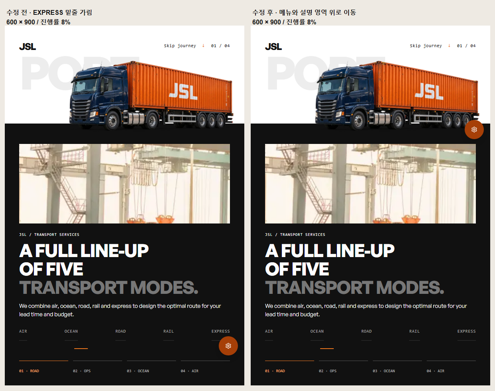

# Intermediate-width theme trigger

Before: 2f36064dd004a0f9ee215031fd31f395fe48a996. After code: 5dcc2c77dd44b4c834c8802d82c722079a9abc1c.
Both are actual READY Vercel builds. Final deployment: dpl_2D6zd4vRY3hTUPtf3BYBXtFe5hzR. Images were not replaced or mocked.

At 600×900 / transport progress 8%, the earlier trigger obstructed the visible EXPRESS underline. The final trigger is above the service-information area. It remains beside the decorative truck; this is a control-obstruction fix, not a redesign of that composition. Desktop placement is preserved by using the engine's 767px mobile boundary.

## Actual browser results
- Chromium emulated viewports: 320×640, 390×844, 600×900, 740×360, 768×1024, 1440×900, `/vi/landing` (transport engine copy remains English).
- Six samples per viewport: 8%, 15%, 22%, 30%, 50%, then reverse to 8%. Wait for the measured engine progress within 0.001 before recording.
- 36 final samples: zero detected obstruction of service/mode buttons, service title/description or tracking form; no offscreen trigger and no page errors.
- Hit-testing samples points 6px apart inside the trigger footprint with its pointer events temporarily disabled, then restores the original style. It detects rendered elements rather than relying only on hidden/clipped rectangles. It is not an exhaustive pixel or full-page overlap proof.
- Six viewports: theme panel opened and Escape restored trigger focus. Light/Dark switched at 600px; [dark capture](dark-600.png). The transport scene retains its authored light/dark areas.
- `preview-results.json` holds the measurements. `capture.cjs` is the exact local runner; its existing browser/module/output paths are machine-specific. Access URL was supplied through the process environment and is not saved here.
- Initial candidate capture was discarded because assets were still loading and a progress assertion timed out. Final run waits for assets and recalculates scroll after layout changes. Earlier baseline samples at requested 50% did not settle and are not counted as matching before/after comparisons; the displayed 8% pair matches.

## Other validation and limits
Actual-source DOM fixture covers idle scheduling/cleanup, late targets, eight width boundaries and vertically stacked controls. Changed-file ESLint, frontend TypeScript, diff check and scoped design detector pass. Vercel built the tested source successfully.

Not verified: Safari, physical devices, continuous transition frames, reduced-motion in this new run, all languages, full-page occlusion, latest combined PR29/49/52/55/57 tree. Latest-delta different-provider review is pending; no Claude work was dispatched. Keep Draft. No merge or production deployment.
